<div align="center">

  <!-- STUDIO HERO BANNER -->
  

  <br/><br/>

  <!-- QUICK NAVIGATION / DOMAIN PILLS -->
  <a href="#-executive-studio-matrix">
    
  </a>
  <a href="#-agentic-ai--autonomous-systems">
    
  </a>
  <a href="#-technology-ecosystem">
    
  </a>
  <a href="#-flagship-engineering-solutions">
    
  </a>
  <a href="#-engineering-metrics--activity">
    
  </a>
  <a href="#-developer-connect--studio-inquiries">
    
  </a>

  <br/><br/>

  <h3>Architecting High-Throughput Web Platforms, Cross-Platform Mobile Applications, and Autonomous Agentic AI Systems</h3>

</div>

<br/>

---

### ⚡ Executive Studio Matrix

<table width="100%">
  <tr>
    <td width="50%" valign="top">
      <h4>🏢 Engineering Philosophy</h4>
      <p>
        <b>Growth Stack</b> operates at the convergence of resilient software architecture, modern cross-platform engineering, and autonomous AI systems. We design and build production-grade digital infrastructure governed by strict code quality, typed API boundaries, and low-latency execution.
      </p>
      <ul>
        <li><b>Microservices & Distributed Systems:</b> Resilient backends designed for horizontal elasticity and zero downtime.</li>
        <li><b>Modern Reactive Interfaces:</b> Accessible, component-driven web & mobile user interfaces with fluid interaction.</li>
        <li><b>Autonomous AI Orchestration:</b> Practical agentic pipelines that automate complex knowledge and software tasks.</li>
      </ul>
    </td>
    <td width="50%" valign="top">
      <h4>🎯 Active Architectural Thrust (2026)</h4>
      <ul>
        <li><b>Autonomous Multi-Agent Networks:</b> Implementing supervisor-worker topologies using LangGraph, CrewAI, and custom runtimes.</li>
        <li><b>Model Context Protocol (MCP):</b> Authoring bespoke MCP servers & tool-calling layers for IDEs, coding assistants, and automated systems.</li>
        <li><b>Cross-Platform Edge Applications:</b> Building reactive clients in Flutter and native Android with Jetpack Compose.</li>
        <li><b>Intelligent Workflow Automation:</b> Headless browser agents (Playwright) and API event bridges.</li>
      </ul>
    </td>
  </tr>
</table>

<br/>

---

### 🏛️ Engineering Capabilities & Disciplines

<table width="100%">
  <tr>
    <td width="33%" align="center" valign="top">
      <h4>🌐 Full-Stack Web Architecture</h4>
      <p align="left">
        End-to-end full-stack platforms with typed API contracts, server-side rendering, and high-concurrency event-driven backends.
      </p>
      <p align="left">
        <code>React</code> • <code>Next.js</code> • <code>TypeScript</code> • <code>Node.js</code> • <code>FastAPI</code> • <code>TailwindCSS</code>
      </p>
    </td>
    <td width="33%" align="center" valign="top">
      <h4>📱 Android &amp; Mobile Systems</h4>
      <p align="left">
        High-performance native and cross-platform mobile experiences with offline caching, local SQLite/Room storage, and clean architecture.
      </p>
      <p align="left">
        <code>Android SDK</code> • <code>Kotlin</code> • <code>Jetpack Compose</code> • <code>Flutter</code> • <code>Dart</code>
      </p>
    </td>
    <td width="33%" align="center" valign="top">
      <h4>🤖 Agentic AI &amp; Automation</h4>
      <p align="left">
        Autonomous multi-agent workflows, tool calling, RAG pipelines, and intelligent developer assistant integrations.
      </p>
      <p align="left">
        <code>LangGraph</code> • <code>CrewAI</code> • <code>MCP</code> • <code>LlamaIndex</code> • <code>Vector DBs</code> • <code>Python</code>
      </p>
    </td>
  </tr>
</table>

<br/>

---

### 🤖 Agentic AI & Autonomous Systems

The studio builds autonomous software systems capable of perception, planning, tool execution, and self-correction:

```
[ Ingest / Trigger ] ──▶ [ Multi-Agent Supervisor ] ──▶ [ Specialized Workers ]
                                   │                              │
                                   ▼                              ▼
                         [ Reflection & QA ]            [ Tool Calling & MCP ]
                                   │                              │
                                   └──────────────┬───────────────┘
                                                  ▼
                                       [ Verified Output ]
```

- **Tool Calling & MCP Protocol:** Standardized protocol layers granting LLMs secure execution capabilities over local filesystems, external APIs, and developer toolchains.
- **Multi-Agent Orchestration:** Decomposing complex software challenges into parallelized sub-agent networks with explicit state management.
- **RAG & Vector Memory:** Hybrid retrieval architectures coupling semantic vector embeddings with structured relational metadata filters.

<br/>

---

### 🛠️ Technology Ecosystem

#### 💻 Frontend & Interface Engineering
<p>
  
</p>

#### ⚙️ Backend, Microservices & APIs
<p>
  
</p>

#### 📱 Android & Mobile Development
<p>
  
</p>

#### 🧠 AI, Machine Learning & Agentic Frameworks
<p>
  
</p>

#### 🗄️ Databases, Cloud & DevOps Infrastructure
<p>
  
</p>

<br/>

---

### 📦 Flagship Engineering Solutions

<table width="100%">
  <tr>
    <td width="50%" valign="top">
      <h4>⚡ Autonomous Multi-Agent Orchestrator</h4>
      <p>Modular agentic runtime featuring dynamic tool execution, state graph transitions, and MCP protocol integration.</p>
      <p>
        
        
        
      </p>
    </td>
    <td width="50%" valign="top">
      <h4>🌐 Enterprise Full-Stack Reactive Platform</h4>
      <p>High-concurrency web application platform with real-time sync, microservice architecture, and responsive UI system.</p>
      <p>
        
        
        
      </p>
    </td>
  </tr>
  <tr>
    <td width="50%" valign="top">
      <h4>📱 Cross-Platform Intelligent Mobile Client</h4>
      <p>Reactive mobile application featuring on-device edge AI inference, offline-first sync engine, and native UI polish.</p>
      <p>
        
        
        
      </p>
    </td>
    <td width="50%" valign="top">
      <h4>☁️ Cloud-Native Microservices &amp; CI/CD Engine</h4>
      <p>Automated containerized deployment pipeline with zero-downtime rolling updates, automated testing, and metric monitoring.</p>
      <p>
        
        
        
      </p>
    </td>
  </tr>
</table>

<br/>

---

### 📈 Engineering Metrics & Activity

<div align="center">
  <table border="0">
    <tr>
      <td align="center">
        <!-- Live GitHub Readme Stats Card (Theme: TokyoNight, Borderless) -->
        
      </td>
      <td align="center">
        <!-- Live Streak Stats Card (Theme: TokyoNight, Borderless) -->
        
      </td>
    </tr>
  </table>
</div>

<br/>

---

### 📬 Developer Connect & Studio Inquiries

<div align="center">

  <a href="https://github.com/growthstackk">
    
  </a>
  &nbsp;
  <a href="mailto:growthstackhelp@gmail.com">
    
  </a>
  &nbsp;
  <a href="https://github.com/growthstackk?tab=repositories">
    
  </a>

  <br/><br/>

  <sub>Architected with engineering rigor • Designed for GitHub Dark &amp; Light themes • Verified Studio Architecture</sub>

</div>
